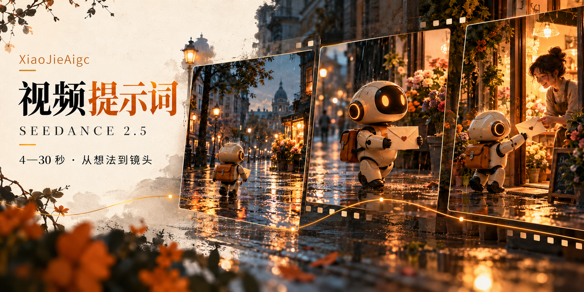

<p align="center">
  
</p>

<h1 align="center">XiaoJieAigc · Seedance 2.5 视频提示词 Skill</h1>

<p align="center"><strong>把创意、素材、脚本与分镜，整理成4—30秒的视频提示词。</strong></p>
<p align="center">从零构思 · 素材分析 · 脚本整理 · 精确分镜 · 镜头与音效</p>
<p align="center"><a href="#快速开始">快速开始</a> · <a href="#安装与导入">安装与导入</a> · <a href="#完整输出示例">输出示例</a> · <a href="./SKILL.md">查看 Skill 正文</a></p>

---

## 这是做什么的？

只有一个想法，也可以开始。有了人物图、场景图、参考视频或现成分镜，也不必重新写一套故事。

这个 Skill 会先判断你要拍什么、有什么素材，再帮你规划动作、镜头与时间，最终给出一份可复制的视频提示词。

> **你提供创意与素材 → Skill 帮你构思与分镜 → 输出完整提示词 → 交给视频模型生成。**

封面为 AI 生成的分镜示意图，并非实际生成视频的截帧。

| 你提供的内容 | Skill 的处理方式 |
| --- | --- |
| 一句话创意 | 确定主体、事件、情绪和结尾，建议合适时长 |
| 人物、场景或道具图 | 分配素材职责，让内容围绕已有素材展开 |
| 参考视频 | 判断要参考动作、运镜、节奏还是转场 |
| 现成脚本 | 保留故事，转成具体画面与时间轴 |
| 精确到秒的分镜 | 优先保留顺序和秒点，补齐缺项、解决冲突 |

## 快速开始

安装或导入后，复制下面的例子给支持 Skill 的 AI 工具：

```text
使用 $xiaojieaigc-seedance-2-5-video-prompt。
我想做一个12秒的温暖短片：送信机器人在雨后的街角，
把一封信交给花店主人。三维动画风格，16:9，没有参考图。
请先帮我考虑动作和镜头，再输出完整视频提示词。
无BGM，保留脚步、水声与信封摩擦声。
```

**已经有素材？这样说：**

```text
使用 $xiaojieaigc-seedance-2-5-video-prompt，帮我做15秒视频提示词。
已上传角色.png、街道.png和参考视频。
角色图只锁定脸、发型与服饰；街道图参考空间与光线；
参考视频只借用镜头节奏，不使用里面的人物和声音。
我想拍角色在雨后发现一束光、停下脚步、微笑的过程。
请判断素材用途，帮我安排动作和分镜，最后输出完整提示词。
```

不支持 `$名称` 的工具，可以选择对应 Skill，或说“使用 Seedance 视频提示词技能”。

## 它会怎样和你配合？

**① 理解输入**　先看你已有的素材、脚本和分镜，不重复问已给的信息。

**② 补齐关键点**　了解想拍什么、多长、什么风格、哪些内容必须保留。

**③ 思考镜头**　安排开场、主要变化和结尾，写清动作方向、摄影机运动、转场与音效。

**④ 检查再交付**　时间从0秒连续覆盖到结束，检查素材引用和角色连续性，输出完整提示词。

没有指定时长时会建议12秒；没有指定画幅时会建议16:9。默认无BGM，保留同步环境音和动作音效；你明确提出音乐、对白或字幕需求时，会按需求调整。

## 提示词的四个部分

| 部分 | 写清什么 |
| --- | --- |
| **基础设定与画质参数** | 总时长、画幅、风格、曝光、节奏与声音设定 |
| **场景与角色光影设定** | 谁出现、穿什么、在哪里、每份素材参考什么 |
| **镜头调度与动作细节** | 第几秒发生什么、怎么拍、怎样衔接、配什么声音 |
| **核心强调与物理约束** | 人物一致、动作路径、焦点目标、倒影、遮挡或结尾构图 |

它会区分“人物怎么动”和“摄影机怎么动”，也会分清“实体、影子、镜面倒影”。不会只用“高级、电影感、丝滑”替代具体镜头描述。

## 完整输出示例

下面是“雨后机器人送信”的12秒文字示例，无需预先准备参考图：

```text
[基础设定与画质参数]
生成一段总时长12秒、16:9的三维动画短片。雨后的傍晚，
暖色花店灯光与清冷街道形成柔和对比，湿润路面保留自然反光。
无BGM，无对白，不添加字幕或水印，保留同步环境音与动作音效。

[场景与角色光影设定]
全片同一台小型送信机器人：奶白色圆润机身、橙色邮差包、
深色面屏与琥珀色发光双眼，双手拿着一封奶白色信封。
花店位于街道右侧，门内暖光照亮门前地面。店主穿深绿色围裙，
站在门口整理花束。保持机器人外形、信封与场景结构一致。

[镜头调度与动作细节设计（12秒全过程）]
第0秒至第4秒（街角跟随）：
画面与运镜：中远景，机器人从画面左侧沿人行道走向右侧花店。
摄影机从侧前方缓慢跟随，机器人绕过小水洼，双手平稳托住信封。
结尾停在花店门前，身体朝向店主。
音效：轻微机械脚步、水洼滴水、远处低弱车流声。

第4秒至第8秒（递出信封）：
画面与运镜：在第4秒硬切至两者侧面的中景。机器人抬头，
将信封向店主递出；店主停下整理花束，伸手接住。
信封从机器人双手连续转移至店主手中，不突然换位或复制。
摄影机缓慢推进，结尾停在双方完成交接的状态。
音效：轻微关节声、衣物摩擦声与信封纸张声。

第8秒至第12秒（温暖收尾）：
画面与运镜：承接交接后的站位，店主低头看信封后微笑，
机器人轻轻点头回应。摄影机缓慢后拉，花束成为画面边缘前景，
最后停留在花店门口的完整构图，人物保留自然微动。
音效：柔和街道环境声、店门风铃声，结尾自然收束。

[核心强调与物理／渲染约束]
全片保持同一机器人与店主，不增加路人或额外信封。
人物动作和摄影机运动分别连续，手部与纸张保持合理接触。
雨后反光与花店光源方向一致，不出现意外黑屏、闪烁和角色变形。
```

示例用于说明文字结构；实际成片效果需在目标视频模型中验证。

## 有自己的分镜，怎么用？

直接上传脚本或粘贴分镜，并说明哪些地方不能改：

```text
使用 $xiaojieaigc-seedance-2-5-video-prompt。
请保留我的镜头顺序和秒点，只补充运镜、光影与音效：
0—4秒：角色走到窗边。
4—8秒：角色停下，镜头从侧后方缓慢靠近。
8—12秒：窗外烟花升起，角色抬头，保持背影结束。
以已上传的角色图锁定身份、发型与服装，不继承白底排版。
最终按四部分规范输出完整提示词。
```

## 安装与导入

**方式一：让支持仓库安装的工具帮你导入。**

```text
请从这个GitHub仓库导入XiaoJieAigc视频提示词Skill：
https://github.com/XiaoJieAi66/XiaoJieAigc-seedance-2-5-video-prompt
技能文件是根目录的SKILL.md。
如果当前工具无法安装，请说明手动导入方法，不要声称安装成功。
安装后，先了解我想拍什么、希望多长，以及有哪些素材、脚本或分镜。
```

**方式二：手动下载。** 点击仓库上方的 **Code → Download ZIP**，解压后，先把技能文件夹重命名为 `xiaojieaigc-seedance-2-5-video-prompt`，再将包含 `SKILL.md` 的 `xiaojieaigc-seedance-2-5-video-prompt` 文件夹导入你使用的工具。具体入口以该工具说明为准。

普通聊天工具没有 Skill 安装能力时，可将 [SKILL.md](./SKILL.md) 全文作为工作说明发给 AI，再提供任务。

## 常见问题

<details>
<summary><strong>4—30秒，代表可以一次生成30秒吗？</strong></summary>

这是本 Skill 的脚本与提示词写作范围。平台的单次时长、分辨率、参考数量与声音能力以实际可用设置为准。需要时可按镜头边界分段，并保持前后角色、服装和状态一致。

</details>

<details>
<summary><strong>没有人物图或场景图，也能用吗？</strong></summary>

可以。Skill 会用文字写清角色、服饰、环境和光线；不会虚构“图1”等不存在的素材。有必要时才建议补充图片。

</details>

<details>
<summary><strong>它会直接生成视频吗？</strong></summary>

核心产物是完整的视频提示词。将提示词与实际素材交给视频模型，并设置支持的时长、画幅和声音参数，才会开始生成。若平台不支持所需声音，可在后期补充。

</details>

---

**先准备角色：** [角色设定图提示词 Skill →](https://github.com/XiaoJieAi66/XiaoJieAigc-character-sheet-prompt)

<p align="center">由 <a href="https://github.com/XiaoJieAi66">XiaoJieAigc</a> 整理 · 让想法变成清楚的镜头</p>
